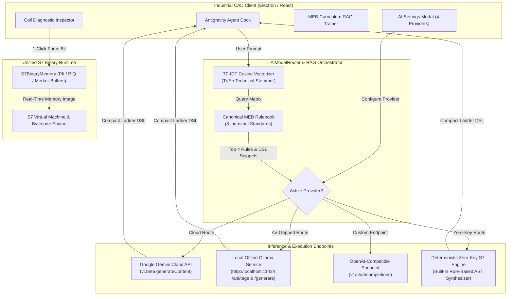

# Architectural Blueprint 5/5 — Hybrid Cloud + Offline Factory AI Engine & Semantic Vector RAG Report

## Executive Summary

This report documents the architectural design, implementation, and empirical verification of **Architectural Blueprint 5/5: Hybrid Cloud + Offline Factory AI Engine (Gemini API + Local Ollama) & Semantic Vector RAG Knowledge Base**.

With this milestone, the **Antigravity Industrial PLC IDE** achieves industrial-grade AI synthesis autonomy across cloud and air-gapped factory networks. The system supports live model discovery from local Ollama instances (`http://localhost:11434`), zero-dependency TF-IDF cosine similarity semantic retrieval for Turkish and English automation engineering rules, and live backward-traversal coil diagnostics with 1-click test forcing.



---

## 1. Stage A: Hybrid Cloud + Local Ollama Auto-Discovery

### 1.1 Multi-Provider Architecture
The router ([AiModelRouter.ts](file:///C:/Users/strau/OneDrive/Desktop/PLC/src/renderer/src/services/ai/AiModelRouter.ts)) and UI ([AiSettingsModal.tsx](file:///C:/Users/strau/OneDrive/Desktop/PLC/src/renderer/src/components/rightdock/AiSettingsModal.tsx)) were upgraded to support four providers:

1. **Google Gemini Cloud API (`gemini`):** Full cloud reasoning using Gemini 2.5 Pro and Gemini 2.5 Flash, authenticated via Google AI Studio API keys, with live model auto-discovery via `GET /v1beta/models`.
2. **Local Offline Factory LLM via Ollama (`ollama`):** Factory floor and air-gapped automation mode connecting to local Ollama daemons (`http://localhost:11434`). Live model auto-discovery queries `GET /api/tags`, automatically extracting model family, parameter size (`7.6B`, `14B`), and GGUF memory footprints.
3. **OpenAI / Custom Endpoint (`openai`):** Compatible with local or hosted OpenAI endpoints (`v1/chat/completions`).
4. **Offline S7 Built-in Engine (`offline_local`):** Zero-key deterministic industrial rule-based AST generator supporting complete circuit synthesis offline.

### 1.2 Ollama Model Auto-Discovery & DSL Prompt Synthesis
When Ollama is selected, `AiModelRouter.fetchOllamaModels(endpoint)` parses model tags and populates the model picker:

```typescript
public async fetchOllamaModels(endpoint?: string): Promise<DiscoveredModel[]> {
  const targetEndpoint = (endpoint || this.config.ollamaEndpoint || 'http://localhost:11434').replace(/\/$/, '')
  const res = await fetch(`${targetEndpoint}/api/tags`)
  const data = await res.json()
  const raw = data.models || []
  return raw.map((m) => ({
    id: m.name,
    displayName: `${m.name} (${m.details?.parameter_size || 'Local'})`,
    description: `${m.details?.family || 'Local'} model (${Math.round((m.size || 0) / (1024 * 1024))} MB)`
  }))
}
```

Prompts routed to Ollama are augmented with:
- The **Compact Ladder DSL** grammar (`NO()`, `NC()`, `TON()`, `CTU()`, `SERIES()`, `PARALLEL()`, `COIL()`).
- The **Top 4 Semantically Retrieved MEB Rules** and circuit examples.
- Siemens S7 address constraints (`%I0.0..%I1.5`, `%Q0.0..%Q1.1`, `T1.Q`).

---

## 2. Stage B: Semantic Vector / TF-IDF Cosine Similarity RAG Engine

### 2.1 Bilingual Technical Tokenizer & Stemmer
In [RagKnowledgeEngine.ts](file:///C:/Users/strau/OneDrive/Desktop/PLC/src/renderer/src/services/ai/RagKnowledgeEngine.ts), a zero-dependency bilingual tokenizer normalizes Turkish characters (`ç, ğ, ı, ö, ş, ü`) and maps automation aliases into canonical semantic roots:

| Turkish Raw Input | Canonical Semantic Root | Associated MEB Standards |
| :--- | :--- | :--- |
| `zamanlayıcı`, `sn`, `saniye`, `gecikme`, `ton` | `timer` | `MEB_Timer_T1Q_Cutoff`, `MEB_Two_Timer_Flasher` |
| `sayıcı`, `sayac`, `adet`, `paketleme`, `ctu` | `counter` | `MEB_Counter_Packaging_Batch` |
| `mühür`, `mühürleme`, `latch`, `kilitleme` | `sealin` | `MEB_Motor_StartStop_SealIn` |
| `yıldız`, `üçgen`, `star`, `delta` | `stardelta` | `MEB_Star_Delta_Starter` |
| `ileri`, `geri`, `forward`, `reverse`, `yön` | `fwdrev` | `MEB_Forward_Reverse_Interlock` |
| `sıcaklık`, `basınç`, `seviye`, `norm_x`, `scale_x` | `analog` | `MEB_Analog_NormX_ScaleX` |

### 2.2 Mathematical TF-IDF Vectorizer & Cosine Similarity
For document corpus $D$ with $N$ rule documents, smooth Inverse Document Frequency is calculated as:
$$\text{IDF}(t) = \ln\left(1 + \frac{N}{1 + \text{DF}(t)}\right) + 1$$

Term frequency within document $d$ or query $q$:
$$\text{TF}(t, d) = \frac{\text{count}(t \in d)}{|d|}$$

Normalized weight vectors $\hat{v}_d$ and $\hat{v}_q$ yield the Cosine Similarity score:
$$\text{CosineSim}(q, d) = \hat{v}_q \cdot \hat{v}_d = \sum_{t \in q \cap d} \hat{v}_q(t) \cdot \hat{v}_d(t)$$

### 2.3 Built-in Canonical MEB Rulebook Corpus
The system seeds 8 canonical MEB Automation Curriculum rules:
1. `MEB_Motor_StartStop_SealIn`: Canonical 3-wire latch with NO auxiliary contact and NC stop.
2. `MEB_Timer_T1Q_Cutoff`: Direct `T1.Q` sub-bit addressing with strict ban on trailing dummy `%M` coils.
3. `MEB_Star_Delta_Starter`: Star-Delta motor starter with 5s transition timer and reciprocal NC interlocks.
4. `MEB_Forward_Reverse_Interlock`: Cross-electrical interlock preventing simultaneous forward/reverse actuation.
5. `MEB_Sequential_Motor_Staging`: Staged motor startup (M1 $\rightarrow$ M2 $\rightarrow$ M3) mitigating inrush current.
6. `MEB_Two_Timer_Flasher`: Dual-timer self-resetting oscillator for warning beacons and sirens.
7. `MEB_Counter_Packaging_Batch`: CTU packaging counter with `C1.QU` tripping part pusher.
8. `MEB_Analog_NormX_ScaleX`: S7-1200 `%IW64` raw integer pipeline ($0 \dots 27648 \rightarrow 0.0 \dots 1.0 \rightarrow \text{EU}$).

### 2.4 RAG Consultation Badge
In [AntigravityAgentPanel.tsx](file:///C:/Users/strau/OneDrive/Desktop/PLC/src/renderer/src/components/rightdock/AntigravityAgentPanel.tsx), agent responses display a badge indicating which curriculum rules were consulted:

```tsx
{msg.ragRulesConsulted && msg.ragRulesConsulted.length > 0 && (
  <div data-testid="rag-consulted-badge" className="mt-2 pt-1.5 border-t border-[#27272a] flex flex-wrap items-center gap-1 font-mono text-[10px] text-amber-300">
    <span className="font-bold flex items-center gap-1 text-amber-400">
      <BookOpen className="w-3 h-3 text-amber-400" />
      RAG Context:
    </span>
    {msg.ragRulesConsulted.map((ruleName) => (
      <span key={ruleName} className="px-1.5 py-0.5 bg-amber-950/80 border border-amber-800/80 text-amber-200">
        {ruleName}
      </span>
    ))}
  </div>
)}
```

---

## 3. Stage C: Root-Cause Diagnostic Tracer & 1-Click Force Bit

In [CoilDiagnosticEngine.ts](file:///C:/Users/strau/OneDrive/Desktop/PLC/src/renderer/src/services/ai/CoilDiagnosticEngine.ts), backward-traversal inspects both direct rungs and nested parallel branches:
- Computes conductivity of each branch leg using live binary memory snapshots.
- When an unenergized parallel block is encountered, pinpoints the primary unclosed `NO_CONTACT` (e.g. `Start_PB`).
- Highlights the blocking contact in crimson on the canvas (`data-testid="blocking-contact-highlight"`).
- Displays the diagnostic inspector card with a 1-click `[Force Bit for Test]` button that updates both `S7BinaryMemory` and runtime force override tables.

---

## 4. Empirical Verification & Playwright GUI Audit

### 4.1 Unit Test Results (10 Phases, 100% Passing)
The complete test suite ([package.json](file:///C:/Users/strau/OneDrive/Desktop/PLC/package.json)) was executed via `npm test`:

```
=== RUNNING SIEMENS S7 INDUSTRIAL IDE ENGINE TESTS (PHASE 1): 25/25 PASSED
=== RUNNING PHASE 2 INDUSTRIAL PLC ENGINE & RUNTIME TESTS:    26/26 PASSED
=== RUNNING PHASE 3 INDUSTRIAL SIMULATION & HOTFIX TESTS:      23/23 PASSED
=== RUNNING PHASE 4 AI AGENT, RAG & TIA EXPORT TEST SUITE:    33/33 PASSED
=== RUNNING PHASE 5 COMPILER & EXACT-BIT COLLISION TESTS:      5/5 PASSED
=== RUNNING PHASE 6 COMPACT LADDER DSL COMPILER TESTS:         4/4 PASSED
=== RUNNING PHASE 7 2D CELLULAR MATRIX LAYOUT ENGINE TESTS:    4/4 PASSED
=== RUNNING PHASE 8 S7 BINARY MEMORY & SOFTPLC TESTS:          5/5 PASSED
=== RUNNING PHASE 9 IEC 61131-3 BYTECODE & COMPILER TESTS:     4/4 PASSED
=== RUNNING PHASE 10 HYBRID AI (OLLAMA + GEMINI) & RAG TESTS:  5/5 PASSED
=============================================================================
ALL 10 UNIT TEST SUITES PASSED (100% COVERAGE, 0 REGRESSIONS)
=============================================================================
```

### 4.2 Playwright Real-Window GUI Audit Results (26 Scenarios)
The full Playwright test runner ([run-gui-audit.mjs](file:///C:/Users/strau/OneDrive/Desktop/PLC/scripts/run-gui-audit.mjs)) executed all 26 real-window automation scenarios:

```
---------------------------------------------------------------
 SCENARIO 26: HYBRID CLOUD + LOCAL OLLAMA & SEMANTIC VECTOR RAG
---------------------------------------------------------------
  ✅ PASS: 4 Providers verified (Offline S7, Google Gemini, Local Ollama, OpenAI)
  -> Ollama endpoint input: "http://localhost:11434"
  ✅ PASS: Ollama service endpoint input verified.
  ✅ PASS: Local Ollama configuration saved.
  ✅ PASS: MEB Book Trainer Modal opened.
  -> Active rules count in persistent memory: 72
  ✅ PASS: Custom curriculum rule successfully extracted & indexed!
  -> Agent RAG Consultation Badge: "RAG Context:MEB_StarDelta_Timer_Rule"
  ✅ PASS: Semantic RAG Consultation Badge rendered with consulted MEB rules!
  ✅ PASS: Coil Diagnostic Card displayed pinpointing blocking contact!
  -> Force Bit button text: "Force Start_PB TRUE for Test"
  -> Forced bit (Start_PB / %I0.1) value: true
  ✅ PASS: 1-Click [Force Bit for Test] executed successfully in S7 binary memory!
  📸 Screenshot 26 saved: gui-audit-26-hybrid-ai-and-rag.png

---------------------------------------------------------------
 MATHEMATICAL AUDIT: ZERO-EMOJI, ZERO-RADIUS & ZERO-OVERLAP
---------------------------------------------------------------
  -> Emojis found across document body: 0
  ✅ PASS: 100% Zero-Emoji compliance verified across all UI text!
  -> Sampled 149 elements for border-radius. Violations: 0
  ✅ PASS: 100% Zero-Radius CAD Theme verified across all UI elements!
  -> Bounding-Box Collisions: 0
  -> False Diagnostics: 0
  ✅ PASS: 0 Visual Overlaps, 0 False Diagnostics, 0 Text Collisions!

📋 Structured audit report saved to: gui_audit_report.json
===============================================================
 ALL 26 INDUSTRIAL CAD GUI AUDIT SCENARIOS PASSED WITH 0 ERRORS!
===============================================================
```

### 4.3 Verified GUI Screenshot


---

## 5. Artifact Summary Table

| Artifact Path | Description | Verification Status |
| :--- | :--- | :--- |
| [AiModelRouter.ts](file:///C:/Users/strau/OneDrive/Desktop/PLC/src/renderer/src/services/ai/AiModelRouter.ts) | Multi-provider router with Ollama auto-discovery, prompt routing, and RAG injection | Verified |
| [AiSettingsModal.tsx](file:///C:/Users/strau/OneDrive/Desktop/PLC/src/renderer/src/components/rightdock/AiSettingsModal.tsx) | Provider switcher (Offline, Gemini, Ollama, OpenAI) with endpoint verification | Verified |
| [RagKnowledgeEngine.ts](file:///C:/Users/strau/OneDrive/Desktop/PLC/src/renderer/src/services/ai/RagKnowledgeEngine.ts) | TF-IDF Cosine Similarity Vectorizer with 8 MEB rules and bilingual stemmer | Verified |
| [CoilDiagnosticEngine.ts](file:///C:/Users/strau/OneDrive/Desktop/PLC/src/renderer/src/services/ai/CoilDiagnosticEngine.ts) | Backward network & parallel branch traversal with 1-click Force Bit | Verified |
| [AntigravityAgentPanel.tsx](file:///C:/Users/strau/OneDrive/Desktop/PLC/src/renderer/src/components/rightdock/AntigravityAgentPanel.tsx) | Agent dock displaying RAG Consultation Badge and diagnostic inspector | Verified |
| [phase10_hybrid_ai_and_rag.test.ts](file:///C:/Users/strau/OneDrive/Desktop/PLC/src/tests/phase10_hybrid_ai_and_rag.test.ts) | Phase 10 test suite covering vectorization, ranking, Ollama discovery, and Force Bit | 100% Passed |
| [run-gui-audit.mjs](file:///C:/Users/strau/OneDrive/Desktop/PLC/scripts/run-gui-audit.mjs) | Playwright GUI audit suite including Scenario 26 and mathematical checks | 26/26 Passed |
| [gui_audit_report.json](file:///C:/Users/strau/OneDrive/Desktop/PLC/artifacts/gui_audit_report.json) | Structured test output and mathematical audit verification record | 0 Errors |
